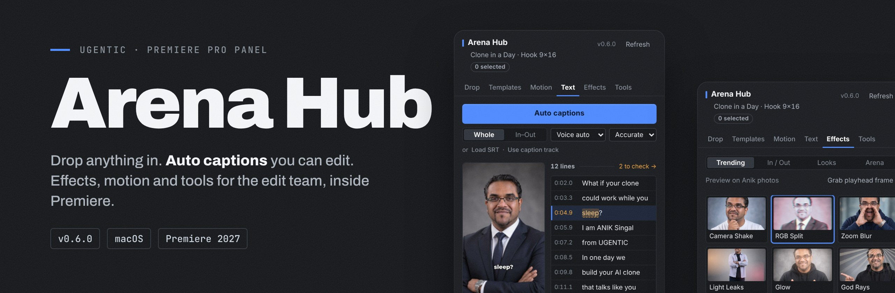
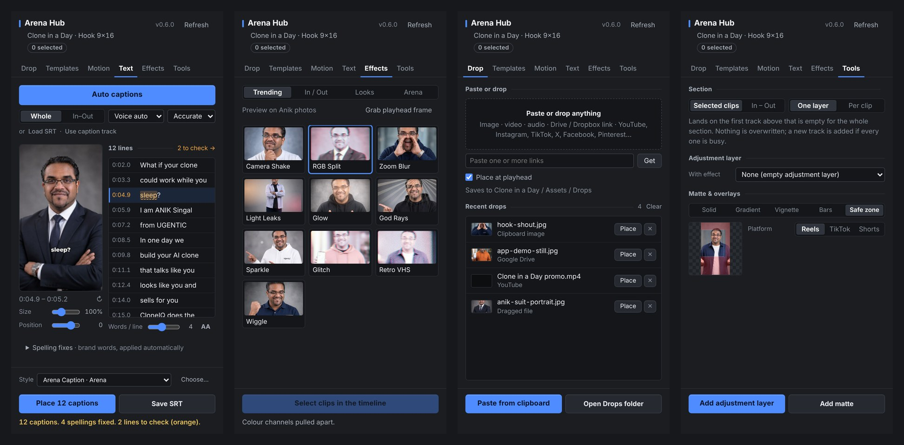

**Arena Hub** is the UGENTIC / Soaring Media edit team's panel inside Premiere Pro. Drop in any file or link, make editable auto captions, apply effects and motion presets, and place adjustment layers and mattes without overwriting anything.

**v0.6.1** · macOS · Premiere Pro 2027 · [What's new](#whats-new)

## Install

Open Terminal, paste this, press Return:

```
curl -fsSL https://raw.githubusercontent.com/agentixclaude/agentix-arena-hub/main/install.sh | bash
```

Restart Premiere → **Window › Extensions › Agentix Arena Hub**.

- The installer also adds **ffmpeg**, **yt-dlp** and **whisper-cpp** through [Homebrew](https://brew.sh) (needed for links and Auto captions). No Homebrew? Install it first, then run the command again.
- **Updates:** the panel shows **Update now** when a new version is on GitHub.
- The first **Auto captions** run downloads the speech model once (Accurate 488 MB, Fast 148 MB).



## The tabs

| Tab | What it does |
|---|---|
| **Drop** | Paste, drag or link anything: images (webp / avif / heic → PNG), video (VP9 / AV1 / webm / mkv → H.264), audio, whole folders, Google Drive / Dropbox / OneDrive links, and social links (YouTube, Instagram, TikTok, X, Facebook, Pinterest, LinkedIn, Reddit, Vimeo…). Saved to `<project>/Assets/Drops`, bin **Arena Drops**, optionally placed at the playhead. **Recent drops:** Clear the list, or ✕ a drop to remove it from the list or delete the file and its project item. |
| **Templates** | The team's picks from the Adobe template library (Carousel 01–05, 1–4) with thumbnails and hover preview. |
| **Motion** | Keyframe presets on the selected clips. |
| **Text** | **Auto captions** for the whole sequence or In–Out, transcribed on your Mac, offline. One line per caption. Unsure words show in orange, and **N to check →** jumps to each one and moves the playhead there so you can listen and fix. **Spelling fixes** correct brand words automatically (ANIK, UGENTIC, CloneIQ, Clone.Studio… add your own). Every line is editable, with a live 9:16 preview and Size / Position. Place as editable Graphics text clips or as a Premiere caption track. Nothing is rendered. Also: Load SRT, Use caption track, Save SRT. |
| **Effects** | 31 recipes in four groups (Trending, In / Out, Looks, Arena) built on Premiere 2027's effects, each with a live preview. |
| **Tools** | Over the selected clips or In–Out: **Adjustment layer** (optionally with any Effects recipe) and **Matte & overlays** (solid, gradient, vignette, bars, Reels / TikTok / Shorts safe zone). Lands on the first free track above, adds a track if needed, never overwrites. |

## Caption style (once)

For Graphics text captions, make one caption template:

1. In Premiere, type a line with the Type tool and style it.
2. Choose **Graphics › Export as Motion Graphics Template**.
3. Drop the `.mogrt` on the Text tab. It is kept in `~/Arena Hub/Caption Templates`.

No template? Pick **Premiere caption track** in Style.

## What's new

- **0.6.1:** Place is ready as soon as Auto captions finish.
- **0.6.0:** Auto captions, with unsure-word review and spelling fixes. Simpler Text tab with a live preview.
- **0.5.1:** previews use bundled photos and work offline. Recent drops: Clear and ✕ delete.
- **0.5.0:** captions stay editable in Premiere. No more rendered .mov captions.

## For maintainers

- The panel lives in `panel/`. Bump `panel/version.json` and the version in `panel/CSXS/manifest.xml`, then push. Every installed panel offers the update.
- Presets: `panel/catalog/motion.json`, `panel/catalog/effects.json`.
- This repo is **public**. Keep footage, exports, `.mogrt` / `.prproj` files, client material, keys and passwords out of it. The only images here are the preview photos in `panel/assets/preview` and the README images in `docs/`.
